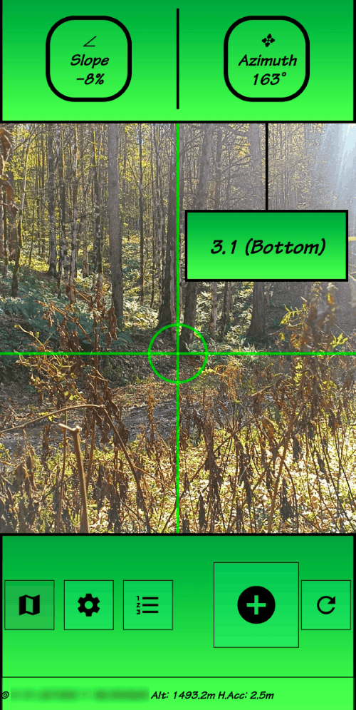
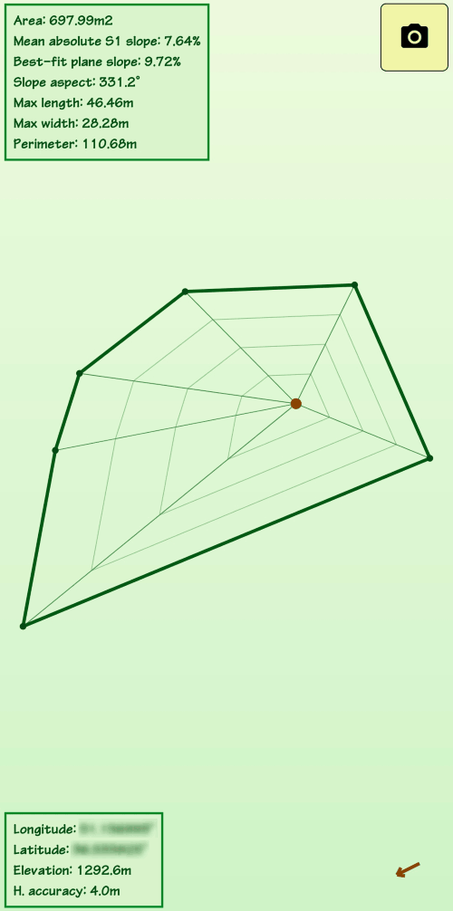

# Canopy Gap
### Android Application for Forest Canopy-Gap Measurement

**Canopy Gap** is an Android application developed by **SilvaResearch** for field measurement of forest canopy-gap geometry and topographic characteristics using smartphone technology.

The application combines camera-based measurements, smartphone orientation sensors, and GPS positioning to help researchers and forestry students measure and document forest canopy gaps.

**Official Website:**  
https://silvaresearch.github.io/

---

## Application Overview

Canopy Gap is designed to support field measurements of forest canopy gaps from a fixed observation point near the center of a gap.

Using smartphone sensors and camera-based measurements, the application estimates the geometric characteristics of canopy gaps and records relevant topographic and geographic information.

It provides a practical tool for researchers working in forest ecology, forest structure, and canopy-gap studies.

## Main Features

- **Gap Area:** Estimation of forest canopy-gap area.
- **Gap Dimensions:** Measurement of gap dimensions.
- **Perimeter:** Calculation of canopy-gap perimeter.
- **Slope Measurement:** Recording ground slope using smartphone orientation sensors.
- **Aspect Measurement:** Recording slope aspect.
- **GPS Positioning:** Recording geographic coordinates.
- **Elevation:** Recording GPS-based elevation.
- **GPS Accuracy:** Recording positioning accuracy.
- **Multiple Measurement Modes:** Free, four-direction, and eight-direction measurement modes.
- **Measurement Reports:** Saving measurement results.

## Application Screenshots

### Canopy Gap Application Interface

### Three-Dimensional Measurement Output

## Measurement Workflow

1. Stand at a fixed measurement point near the center of the forest canopy gap.
2. Select the preferred measurement mode.
3. Configure the measurement settings.
4. Measure the canopy-gap boundaries in the selected directions.
5. Review the calculated geometric and topographic results.
6. Save the measurement report.

## Download

The Canopy Gap Android application is available through the official website.

**[Download Canopy Gap](https://silvaresearch.github.io/files/CanopyGap-v1.00.apk)**

| Application Information | Details |
|---|---|
| Application | Canopy Gap |
| Version | 1.00 |
| Platform | Android |
| File Format | APK |
| File Size | 3.02 MB |
| Release Date | November 15, 2026 |
| Developer | SilvaResearch |

## Purchase & Activation

Canopy Gap requires an activation code.

To purchase the application:

1. Visit the official Purchase & Activation page.
2. Follow the Litecoin payment instructions.
3. Submit your email address and transaction ID (TXID).
4. Your payment will be checked manually.
5. After payment verification, your 24-digit activation code will be sent to your email address.

**[Purchase & Get Activation Code](https://silvaresearch.github.io/purchase.html)**

Please provide an email address that you can access. Your activation code will be sent to that address.

## Official Website

For application information, screenshots, downloads, and activation:

**https://silvaresearch.github.io/**

## Developer

**SilvaResearch**

*Forest is Life.*

## Copyright & License

Copyright © 2026 SilvaResearch. All rights reserved.

Canopy Gap, including its software, design, documentation, and associated materials, is the property of SilvaResearch.

No part of this application may be reproduced, redistributed, modified, or commercially exploited without prior written permission from the copyright holder, except where expressly permitted by applicable law.

This repository provides information about the Canopy Gap application. Access to this repository does not grant permission to copy, modify, or redistribute the application.

---
**Canopy Gap – Forest Canopy-Gap Measurement App**  
**Developed by SilvaResearch**
